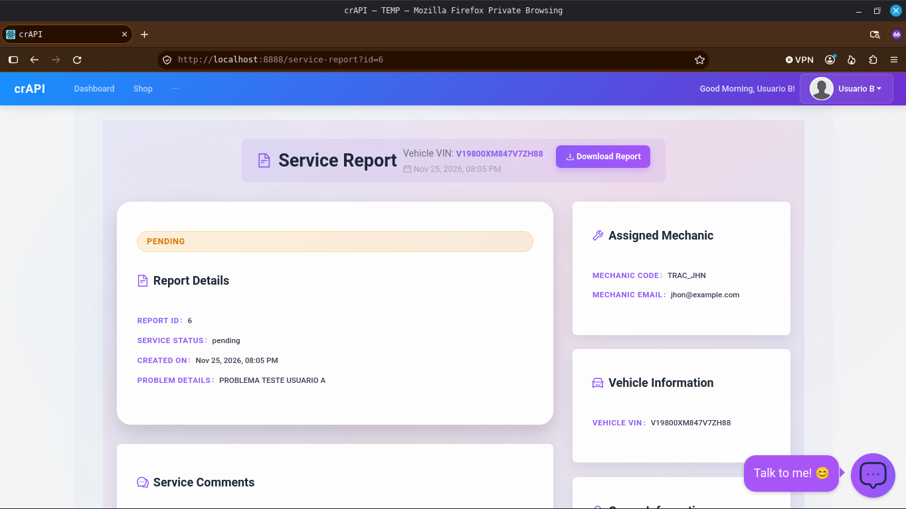
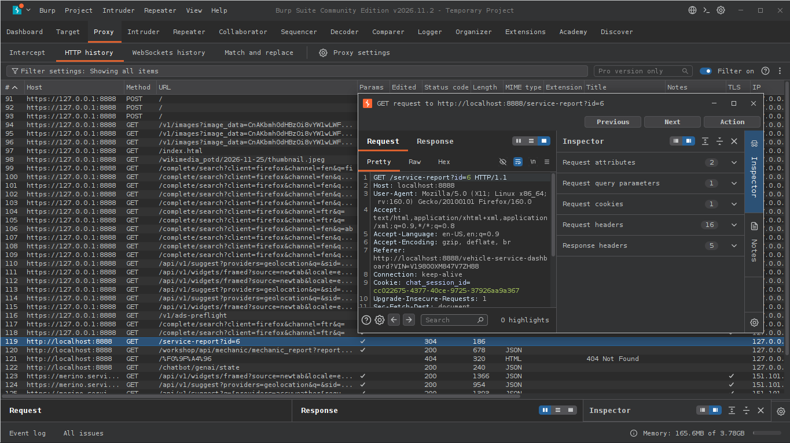
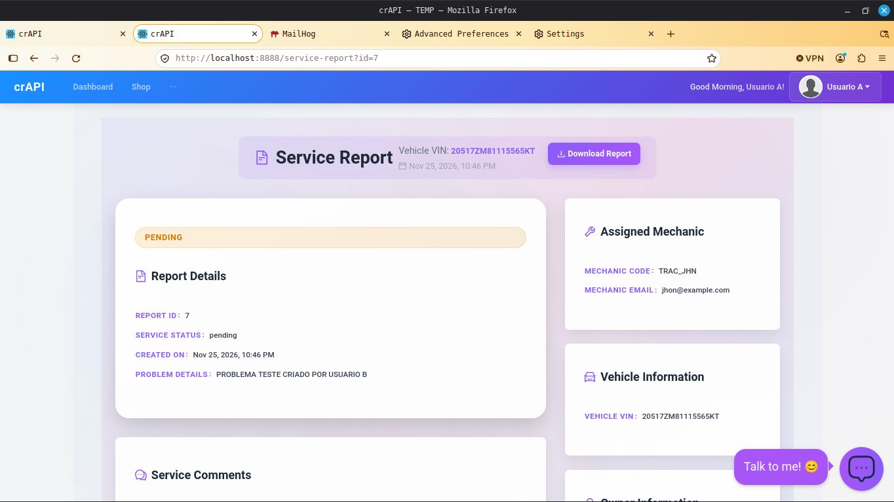

# Joao Ramos DR4 TP3
> Por João Victor Cicero de M. T. Ramos.
> *Novembro de 2026*

---

# Exercício 1

### Contexto

A Vetor Security avança o engajamento contra o crAPI para a fase de exploração de autorização. 

O primeiro alvo é a Broken Object Level Authorization (BOLA), a categoria historicamente mais explorada em incidentes reais de APIs REST e responsável por diversos vazamentos de dados públicos envolvendo aplicações de veículos conectados e serviços financeiros. A falha ocorre quando a API verifica se o usuário está autenticado, mas não verifica se ele é o dono do recurso solicitado. 

Você recebeu dois pares de credenciais válidas de usuários distintos no ambiente de laboratório para conduzir um teste comparativo controlado, sem nunca comprometer contas fora do escopo autorizado.

### Tarefa
1. Autentique-se como Usuário A, capture uma requisição que acesse um recurso pertencente a ele (por exemplo, um veículo cadastrado) e identifique o identificador do recurso na requisição.

2. Realize o teste A-B: substitua o identificador do recurso pelo de um recurso pertencente ao Usuário B, mantendo a sessão do Usuário A, e registre a resposta obtida.

3. Conclua se a API está vulnerável a BOLA nesse endpoint e documente o impacto de negócio da falha encontrada.

### Item 1.1
Podemos verificar o recurso criado pelo usuário A e podemos verificar que foi criado por ele através do código *VIM* do veiculo.

Avaliando a requisição capturada, as informações na tela e o url no navegador, podemos verificar que o ID do objeto `service_report` é `6`

### Item 1.2
Evidencia do usuário A abrindo um `service_report` criado pelo usuario B. podemos verificar que o veiculo relacionado *Não pertence* ao usuario A através do código *VIM* do veículo

### Item 1.3

As evidencias mostram que a API está vulneravel a BOLA, quberando com o principio de confidencialidade, já que um usuario consegue acessar as informações de outro. 

---

# Exercício 2

### Contexto

Além da autorização a nível de objeto, a Vetor Security pede o teste de Broken Function Level Authorization (BFLA): verificar se um usuário sem privilégios administrativos consegue acessar funções restritas a administradores, como gestão de outros usuários ou configurações internas do sistema. 

Esse tipo de falha costuma passar despercebido em revisões de código porque a checagem de papel muitas vezes existe apenas na interface visual da aplicação (o botão administrativo simplesmente não aparece para o usuário comum), mas não é reforçada no backend, que aceita a requisição de qualquer usuário autenticado independentemente do papel atribuído. 

Times de desenvolvimento sob pressão de prazo tendem a confiar demais na camada visual como controle de acesso, um erro que este exercício deve expor de forma concreta e reproduzível.

### Tarefa

1. Identifique, no mapa de endpoints já levantado, funções que aparentam ser restritas a administradores (por exemplo, gestão de usuários ou configurações do sistema).
2. Utilizando um token de usuário comum, tente acessar diretamente essas funções administrativas e registre o resultado.
3. Justifique tecnicamente por que a checagem de autorização precisa ocorrer no backend e não apenas na camada de apresentação, com base no resultado observado.

### Item 2.1
Utilizando a listagem de endpoints do postman criada no TP2, podemos identificar os seguintes endpoints que aparentam ser restritos a administradores:
- ``
- ``
- ``
- ``
- ``
- ``